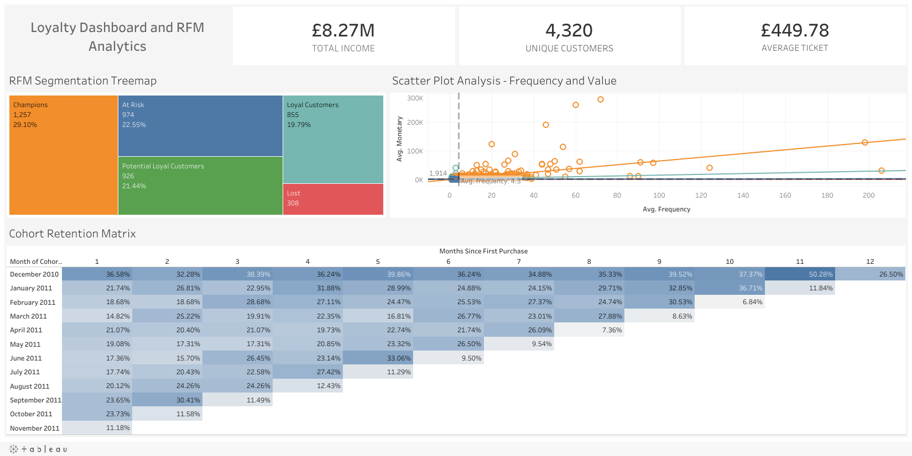

*Read this in other languages: [Español](README_es.md)*

# Customer Retention & Segmentation Analysis (RFM Model & Cohort Analysis)

## Interactive Dashboard

Explore the interactive analysis in Tableau Public:
[View Dashboard in Tableau Public](https://public.tableau.com/app/profile/armando.guarnera/viz/CustomerSegmentation_17824765729530/Dashboard1)

## Dashboard Preview



## Business Context

A UK-based online retailer specializing in giftware and home décor has seen its sales growth stall. Marketing has been investing heavily in acquiring new customers, while the Customer Acquisition Cost (CAC) keeps rising.

### The Challenge

Identify the most valuable customers, understand how they buy, and design data-driven retention actions that protect **Customer Lifetime Value (CLV)**.

---

## Project Objectives

* Segment the customer base with the **RFM (Recency, Frequency, Monetary)** methodology.
* Measure how many new customers come back with a **monthly cohort retention analysis**.
* Deliver an interactive **Tableau dashboard** that lets Marketing filter and target campaigns by customer profile.

---

## Tech Stack

### Python (Pandas)

* Data cleaning and wrangling
* Handling of cancellations and duplicates
* Customer-level feature engineering
* Quantile-based RFM scoring

### Tableau

* Level of Detail (LOD) expressions
* Nested LOD expressions (cohort size and retention)
* Dashboard actions and interactive filters
* Dashboard UX/UI design

### Statistics

* Cohort analysis
* Quantile-based segmentation
* Descriptive analytics

---

## Process and Methodology

### 1. Data Extraction and Cleaning (ETL)

The project uses the real **Online Retail** dataset from the UCI Machine Learning Repository: 541,909 invoice lines from December 2010 to December 2011. The script `etl_pipeline.py`:

* Removes lines without a `CustomerID` (135,080 lines, 24.9%): they are real sales, but they cannot be attributed to a customer.
* Removes exact duplicate lines and non-product codes (postage, bank charges, manual adjustments, discounts).
* **Keeps cancellations as negative revenue.** Cancelled invoices (prefix `C`) are netted against purchases, so the monetary value reflects money the business actually kept (£382,501 in cancellations). Dropping only the cancellation line would keep purchases that were later returned.
* Computes Recency and Frequency from purchases only (a cancellation is not a visit) and Monetary from all lines (net revenue).
* Excludes customers whose net revenue is not positive.

Result: **399,656 clean lines** (8,506 of them cancellations) and **4,320 customers** segmented.

---

### 2. Customer Segmentation Modeling (RFM)

Each customer receives a score from **1 to 4** based on their quantile in three dimensions:

* **Recency:** days since the last purchase.
* **Frequency:** number of distinct purchase invoices.
* **Monetary:** net amount spent (GBP).

The combined score (3 to 12) assigns each customer to one of five segments:

| Segment | RFM score | Customers | Median recency (days) | Median orders | Median net spend |
|---|---|---|---|---|---|
| Champions | 10-12 | 1,257 | 13 | 7 | £2,422 |
| Loyal Customers | 8-9 | 855 | 36 | 3 | £870 |
| Potential Loyal Customers | 6-7 | 926 | 63 | 2 | £463 |
| At Risk | 4-5 | 974 | 164 | 1 | £276 |
| Lost | 3 | 308 | 269 | 1 | £155 |

---

### 3. Visualization and Analysis (Tableau)

An executive-level interactive dashboard that includes:

* **KPI cards:** net revenue, unique customers and average order value (net revenue divided by purchase invoices).
* **Cohort retention matrix:** share of each monthly cohort (month of first purchase) that buys again N months later. The cohort is computed with an LOD expression over purchases only, and retention divides the customers who bought each month by the cohort size, computed with a second LOD expression.
* **RFM segment treemap:** size and share of each segment; clicking a segment filters the whole dashboard.
* **Frequency vs. value scatter plot:** one point per customer, with average reference lines.

---

## Key Findings and Recommendations

### 1. A Small Group Drives the Business

**Champions** are **29.1% of the customers** but generate **76.9% of net revenue**.

**Recommended action:** a VIP retention program for this group (account management, early access, service guarantees) instead of generic discounts they do not need.

---

### 2. Only One in Five New Customers Comes Back the Next Month

For the cohorts from January to October 2011, the median share of customers who buy again in the month after their first purchase is **19.6%** (range 14.8% to 23.7%).

**Recommended action:** an automated onboarding sequence during the first 30 days after the first purchase, measured against this baseline.

**Reading note:** the December 2010 cohort retains far more (36.6% in month 1) because the dataset starts that month: it mixes new customers with existing ones. And the last diagonal of the matrix falls because December 2011 only has 9 days of data, not because customers left.

---

### 3. "At Risk" Means Low Engagement, Not Lost VIPs

The **At Risk** segment (974 customers) has a median of **one order** and **£276** of net spend, with 164 days since the last purchase. Most are one-time buyers who never came back, not former top customers.

**Recommended action:** a low-cost automated win-back campaign, reserving premium incentives for customers with high historical value.

---

## Limitations and Next Steps

* The summed RFM score can place very different customers in the same segment (for example, high spend with low recency and low spend with medium recency). A recency x frequency-monetary grid, or behavioral clustering, would separate them better.
* The analysis covers identifiable customers only (75.1% of invoice lines).

---

## How to Run This Project

```bash
git clone https://github.com/arguar13/Tableau-RFM-Cohort-Analysis.git
cd Tableau-RFM-Cohort-Analysis
pip install -r requirements.txt
python etl_pipeline.py
```

The script downloads the dataset and creates `ecommerce_cleaned_rfm.csv`. Then open `Customer Segmentation.twbx` in Tableau Desktop or Tableau Public: the packaged workbook includes its data extract, so it opens directly.

---

## Data Source

Chen, D. (2015). *Online Retail* [Dataset]. UCI Machine Learning Repository. https://doi.org/10.24432/C5BW33

---

## Author

**Armando Guarnera**
Data Scientist
Argentina
