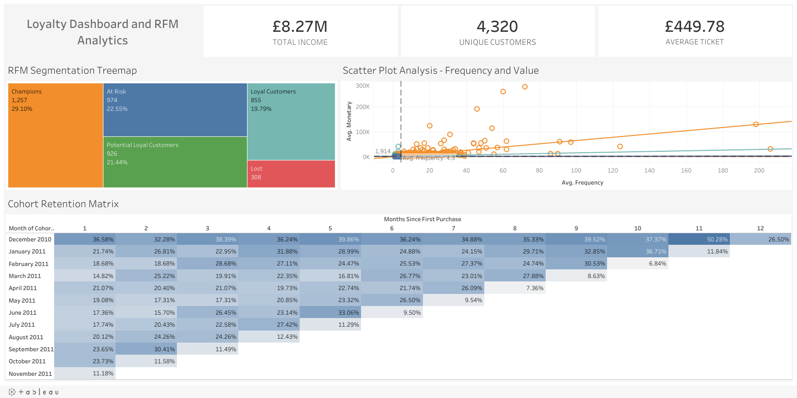

*Lee este documento en otros idiomas: [English](README.md)*

# Análisis de Retención y Segmentación de Clientes (Modelo RFM y Análisis de Cohortes)

## Dashboard Interactivo

Explora el análisis interactivo en Tableau Public:
[Ver Dashboard en Tableau Public](https://public.tableau.com/app/profile/armando.guarnera/viz/CustomerSegmentation_17824765729530/Dashboard1)

## Vista Previa del Dashboard



## Contexto de Negocio

Un minorista en línea del Reino Unido especializado en regalos y decoración para el hogar ve estancado su crecimiento de ventas. Marketing invierte fuertemente en adquirir clientes nuevos, mientras el Costo de Adquisición de Clientes (CAC) sigue subiendo.

### El Desafío

Identificar a los clientes más valiosos, entender cómo compran y diseñar acciones de retención basadas en datos que protejan el **Valor del Ciclo de Vida del Cliente (CLV)**.

---

## Objetivos del Proyecto

* Segmentar la base de clientes con la metodología **RFM (Recencia, Frecuencia y Valor Monetario)**.
* Medir cuántos clientes nuevos vuelven a comprar con un **análisis de retención por cohortes mensuales**.
* Entregar un **dashboard interactivo en Tableau** que permita a Marketing filtrar y orientar campañas por perfil de cliente.

---

## Stack Tecnológico

### Python (Pandas)

* Limpieza y preparación de datos
* Tratamiento de cancelaciones y duplicados
* Ingeniería de variables a nivel cliente
* Puntuación RFM basada en cuantiles

### Tableau

* Expresiones Level of Detail (LOD)
* Expresiones LOD anidadas (tamaño de cohorte y retención)
* Acciones de dashboard y filtros interactivos
* Diseño UX/UI de dashboards

### Estadística

* Análisis de cohortes
* Segmentación basada en cuantiles
* Analítica descriptiva

---

## Proceso y Metodología

### 1. Extracción y Limpieza de Datos (ETL)

El proyecto usa el dataset real **Online Retail** del UCI Machine Learning Repository: 541.909 líneas de factura entre diciembre de 2010 y diciembre de 2011. El script `etl_pipeline.py`:

* Elimina las líneas sin `CustomerID` (135.080 líneas, 24,9%): son ventas reales, pero no se pueden atribuir a un cliente.
* Elimina líneas duplicadas exactas y códigos que no son productos (envíos, comisiones bancarias, ajustes manuales, descuentos).
* **Conserva las cancelaciones como ingreso negativo.** Las facturas canceladas (prefijo `C`) se netean contra las compras, de modo que el valor monetario refleja el dinero que el negocio realmente conservó (£382.501 en cancelaciones). Eliminar solo la línea de cancelación mantendría compras que luego se devolvieron.
* Calcula Recencia y Frecuencia solo con compras (una cancelación no es una visita) y el Valor Monetario con todas las líneas (ingreso neto).
* Excluye a los clientes cuyo ingreso neto no es positivo.

Resultado: **399.656 líneas limpias** (8.506 de ellas cancelaciones) y **4.320 clientes** segmentados.

---

### 2. Modelado de Segmentación de Clientes (RFM)

Cada cliente recibe una puntuación de **1 a 4** según su cuantil en tres dimensiones:

* **Recencia:** días desde la última compra.
* **Frecuencia:** cantidad de facturas de compra distintas.
* **Valor Monetario:** monto neto gastado (GBP).

La puntuación combinada (3 a 12) asigna a cada cliente uno de cinco segmentos:

| Segmento | Puntuación RFM | Clientes | Recencia mediana (días) | Pedidos (mediana) | Gasto neto (mediana) |
|---|---|---|---|---|---|
| Champions | 10-12 | 1.257 | 13 | 7 | £2.422 |
| Loyal Customers | 8-9 | 855 | 36 | 3 | £870 |
| Potential Loyal Customers | 6-7 | 926 | 63 | 2 | £463 |
| At Risk | 4-5 | 974 | 164 | 1 | £276 |
| Lost | 3 | 308 | 269 | 1 | £155 |

---

### 3. Visualización y Análisis (Tableau)

Un dashboard interactivo de nivel ejecutivo que incluye:

* **Tarjetas KPI:** ingreso neto, clientes únicos y valor promedio por pedido (ingreso neto dividido por facturas de compra).
* **Matriz de retención por cohortes:** porcentaje de cada cohorte mensual (mes de la primera compra) que vuelve a comprar N meses después. La cohorte se calcula con una expresión LOD solo sobre compras, y la retención divide a los clientes que compraron cada mes por el tamaño de la cohorte, calculado con una segunda expresión LOD.
* **Treemap de segmentos RFM:** tamaño y peso de cada segmento; al hacer clic en un segmento se filtra todo el dashboard.
* **Gráfico de dispersión frecuencia vs. valor:** un punto por cliente, con líneas de referencia de promedio.

---

## Principales Hallazgos y Recomendaciones

### 1. Un Grupo Pequeño Sostiene el Negocio

Los **Champions** son el **29,1% de los clientes** pero generan el **76,9% del ingreso neto**.

**Acción recomendada:** un programa de retención VIP para este grupo (gestión de cuenta, acceso anticipado, garantías de servicio) en lugar de descuentos genéricos que no necesitan.

---

### 2. Solo Uno de Cada Cinco Clientes Nuevos Vuelve el Mes Siguiente

En las cohortes de enero a octubre de 2011, la mediana de clientes que vuelven a comprar en el mes posterior a su primera compra es **19,6%** (rango de 14,8% a 23,7%).

**Acción recomendada:** una secuencia automática de bienvenida durante los primeros 30 días tras la primera compra, medida contra esta línea base.

**Nota de lectura:** la cohorte de diciembre de 2010 retiene mucho más (36,6% en el mes 1) porque el dataset empieza ese mes y mezcla clientes nuevos con clientes existentes. Y la última diagonal de la matriz cae porque diciembre de 2011 solo tiene 9 días de datos, no porque los clientes se hayan ido.

---

### 3. "At Risk" Significa Bajo Compromiso, No VIPs Perdidos

El segmento **At Risk** (974 clientes) tiene una mediana de **un pedido** y **£276** de gasto neto, con 164 días desde la última compra. La mayoría son compradores de una sola vez que no volvieron, no ex clientes top.

**Acción recomendada:** una campaña automática de reactivación de bajo costo, reservando los incentivos premium para clientes con alto valor histórico.

---

## Limitaciones y Próximos Pasos

* La suma de puntuaciones RFM puede ubicar en el mismo segmento a clientes muy distintos (por ejemplo, gasto alto con recencia baja y gasto bajo con recencia media). Una grilla recencia x frecuencia-valor, o un clustering por comportamiento, los separaría mejor.
* El análisis cubre solo a los clientes identificables (75,1% de las líneas de factura).

---

## Cómo Ejecutar Este Proyecto

```bash
git clone https://github.com/arguar13/Tableau-RFM-Cohort-Analysis.git
cd Tableau-RFM-Cohort-Analysis
pip install -r requirements.txt
python etl_pipeline.py
```

El script descarga el dataset y genera `ecommerce_cleaned_rfm.csv`. Luego abre `Customer Segmentation.twbx` en Tableau Desktop o Tableau Public: el workbook empaquetado incluye su extracto de datos, así que abre directamente.

---

## Fuente de Datos

Chen, D. (2015). *Online Retail* [Dataset]. UCI Machine Learning Repository. https://doi.org/10.24432/C5BW33

---

## Autor

**Armando Guarnera**
Científico de Datos
Argentina
